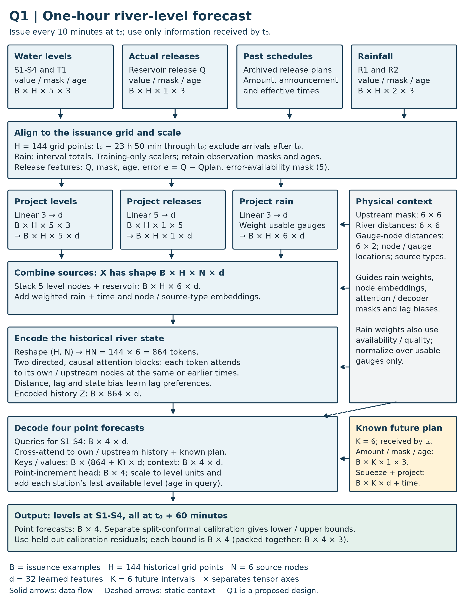
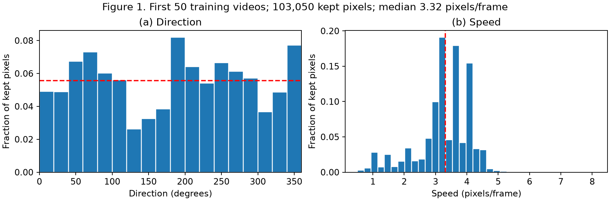
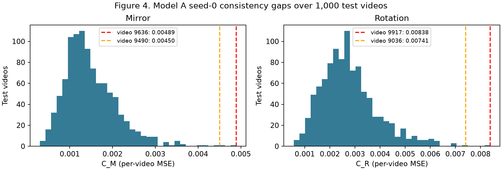
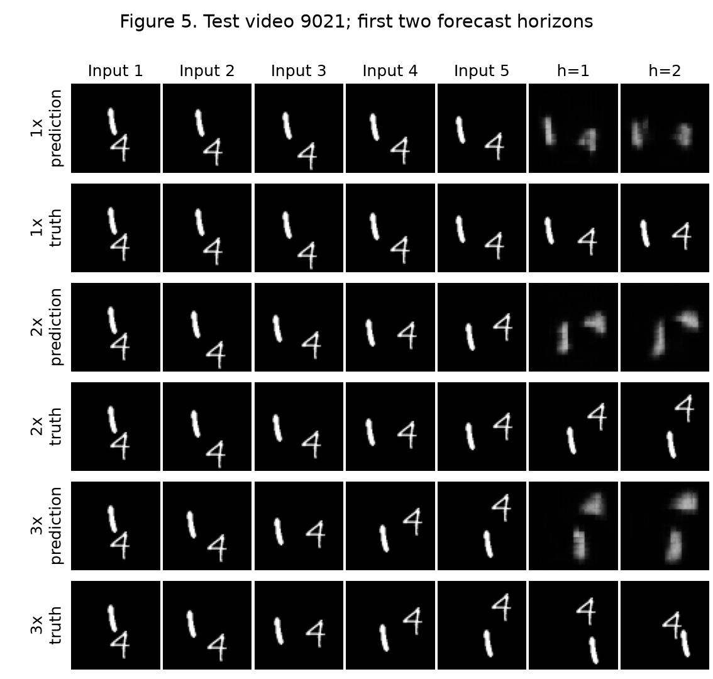

**Name:** Muhammad Sami Ul Basit

**Roll No:** 25280025

**GitHub:** [github.com/msbasit/dl4stg-pa2](https://github.com/msbasit/dl4stg-pa2)

**Execution:** All eight learned runs use final epoch 30, with seeds 0 and 1 on the Intel Arc 140T GPU. The separate Q2 notebook, checkpoints, required figures and GIFs accompany this report.

\newpage

# Question 1 — River Forecasting Proposal

## 1. Architecture diagram

**Reading the dimensions.** $B$ counts issuance examples, $H=144$ historical ten-minute grid points, $N=6$ source nodes (S1-S4, T1 and the reservoir), $d=32$ learned features, and $K=6$ future planned-release intervals. The diagram groups each historical reading with its mask and age: levels are $B\times H\times5\times3$ and rainfall is $B\times H\times2\times3$. For the reservoir, append actual-minus-announced release error and its own availability mask, giving five projected features: $B\times H\times1\times5$. Section 3 lists values and auxiliary tensors separately. After projection, stacking and rain fusion, reshape $B\times H\times N\times d$ into $B\times864\times d$. Four station queries produce four point-level increments; the residual mapping returns physical levels. Separate split-conformal calibration on held-out calibration cases produces the bounds. Point levels, lower bounds and upper bounds are each $B\times4$; stacking them for presentation gives $B\times4\times3$. This packing does not introduce quantile heads or extra forecast times.

The forecast is a learned, directed space–time attention model. The diagram is part of the answer; the following sections specify its inputs and computations. All historical tensors use the same ten-minute grid. Missingness and observation age travel with each value. The reservoir is a source node, not an additional water-level target.

## 2. Assumptions

**A1 — Record length.** Assume at least two years of reasonably representative data, including seasonal variation and some high-flow events. This is a working assumption, not a supplied fact. A small model and chronological validation limit overfitting; if the record is shorter, reduce capacity and retain persistence as a reference. Rare floods remain poorly identified.

**A2 — Timing and availability.** Assume measurement timestamps, arrival timestamps and release-announcement versions can be archived. Historical backtesting reconstructs what was available at each issuance. If historical arrival times are absent, explicitly simulate plausible delays and disclose that operational backtests are approximate.

**A3 — Observation quality.** Assume common units, known station datums and basic quality flags can be established. Fit station-specific scalers using the training period only. Do not treat equal water levels at different stations as equal discharges. Flag implausible jumps and datum changes before forecasting.

**A4 — History.** Start with a 24-hour history (144 samples), assuming it contains useful antecedent rainfall and upstream signals for a one-hour forecast. Validate this window and a longer alternative chronologically; if relevant travel times exceed 24 hours, enlarge the history. The proposed window is not a claimed travel-time measurement.

**A5 — Directionality.** Assume downstream transport dominates over this reach. Directed river-ancestor links are therefore a useful inductive bias. Backwater, tidal or gate-induced upstream effects would violate the hard directional mask; seek evidence and add physically justified reverse edges if needed.

**A6 — Variable propagation.** Assume relevant travel delays vary with current level, recent level changes and operations. Learn lag-dependent attention using distance and state as covariates, without fixing a distance-to-time conversion. Learned weights are predictive associations, not measured travel times.

**A7 — Rainfall relevance.** Assume R1/R2 provide imperfect information about runoff in nearby catchments. Learn gauge-to-node relevance with geographical features; do not infer exact contributing catchments from the illustration. No future observed rain is supplied to the model.

**A8 — Release schedules.** Assume announcements available before issuance are useful but imperfect indicators of actual future releases. Carry an availability mask, announcement age and the latest version known at issuance; train on archived announced schedules rather than retrospectively substituted realised releases.

**A9 — Stability.** Assume relationships are sufficiently stable within an operating season for historical learning to be useful. Monitor residual drift after changes to channels, gauges or reservoir policies and retrain when needed. This does not assume flood extremes are represented adequately.

## 3. Forecasting task and data specification

Let $t_0$ be an issuance on the ten-minute grid and $\Delta=10$ minutes. Use $H=144$ historical grid points $t_0-143\Delta,\ldots,t_0$, subject to arrival-time filtering. Predict $y_{b,i}=\ell_i(t_0+6\Delta)$ for $i\in\{S1,S2,S3,S4\}$. This is one target time, not six output horizons. $B$ denotes independent issuance examples; $N=6$ source nodes are $(S1,S2,S3,S4,T1,Q)$, where $Q$ is reservoir release.

| Tensor | Dimensions and axis meanings | Coverage / availability |
|---|---|---|
| Historical water levels $L$ | $B\times144\times5\times1$: issuance, time, $(S1\ldots S4,T1)$, value | Historical event times through $t_0$, arrived by $t_0$ |
| Historical actual releases $Q$ | $B\times144\times1\times1$: issuance, time, reservoir, release | Same historical grid; arrived by $t_0$ |
| Historical plan discrepancy $J$ | $B\times144\times1\times2$: issuance, time, reservoir, (actual minus earlier announced release, availability mask) | Computed only where both the earlier archived plan and actual release are available by $t_0$ |
| Rainfall $P$ | $B\times144\times2\times1$: issuance, interval, $(R1,R2)$, amount | Accumulation over each interval ending on grid; received by $t_0$ |
| Masks $m$ and ages $a$ | Each has the same shape as its historical value tensor | Whether a usable reading exists; elapsed time since latest available measurement; no future interpolation |
| Announced release plan $U$ | $B\times6\times1\times3$: issuance, future interval, reservoir, (scheduled release, availability mask, announcement age) | Effective intervals $(t_0,t_0+\Delta],\ldots,(t_0+5\Delta,t_0+6\Delta]$; only announcements made and received by $t_0$ |
| Static node metadata $S$ | $6\times4$: node, (easting, northing, river chainage, source-type code) | Surveyed locations; coordinates projected to common metric CRS; source type embedded categorically |
| Gauge metadata $G$ | $2\times2$: rain gauge, (easting, northing) | Supplied gauge locations; known before issuance |
| Directed river mask $A$ and distances $D$ | Each $6\times6$: destination, source | Self/ancestor connectivity and along-river distances; distances used only on connected river pairs |
| Gauge-node distances $D^P$ | $6\times2$: destination node, rain gauge | Computed geographical distance; not river travel distance |
| Target $Y$ | $B\times4$: issuance, station $(S1\ldots S4)$ | Water level at $t_0+60$ minutes; used only for supervision after it becomes available |
| Target validity $m^Y$ | $B\times4$: issuance, station | Quality/availability of the target; supervision metadata only, never an issuance-time input |
| Forecast $\widehat Y$ and interval | Each $B\times4$ | Point level and calibrated lower/upper bounds at $t_0+60$ minutes |

Align by event time rather than by row number. Aggregate rain as interval totals, actual releases as time-weighted interval means, and water levels as the latest valid interval-end observation. Never interpolate using a later arrival or future measurement. For multiple rain reports, avoid double-counting accumulation periods. Forward-fill briefly for numerical input, retain the original observation mask and increasing age, then use a training-period neutral value for long gaps. Scale rainfall and release separately from level. Store the latest release-plan version known at issuance for every effective future interval; unknown plans remain masked, rather than being labelled zero. Use held-last actual release only as an explicit fallback scenario.

## 4. Model computations and design justification

The proposal uses width $d=32$ and two residual attention blocks, with layer normalization and small feed-forward maps. These are proposed design choices; no fitted results are claimed. Project each source's $(v,m,a)$, its metadata and time position into $z_{j,s}\in\mathbb R^{32}$. For the reservoir, append the two historical discrepancy features $J$ to this source vector; for level sources omit them. Different source types have separate value projections because level and discharge are different quantities. Project each rain-gauge token similarly; combine gauges at each historical node/time through learned normalized weights $\beta_{jr,s}$ depending on gauge/node location, distance and data quality:

Denote the source vector just defined by $r_{j,s}$ (three features for a level source, five for the reservoir including $J$). Then

$$e_{j,s}=W_{\mathrm{type}(j)}r_{j,s}+E(S_j)+E_t(s),\qquad z_{j,s}=e_{j,s}+\sum_{r=1}^2\beta_{jr,s}W_P[P_{r,s},m^P_{r,s},a^P_{r,s}].$$

After projection, stack the five level embeddings and one reservoir embedding on the node axis to form $B\times144\times6\times32$; the unequal raw source vectors are not concatenated along their feature axis. Rainfall weights sum to one over usable gauges; if both are missing, use a missing-rain token. Rainfall is not converted to exact inflow. River distance is not used to define the gauge weights.

Flatten the historical $(144,6)$ axes into 864 tokens. For each destination token $(i,s)$, attend only to its own or upstream source tokens $(j,u)$ with $u\le s$:

$$a_{is,ju}=\frac{(W_qz_{i,s})^\top(W_kz_{j,u})}{\sqrt d}+b_\theta(D_{ij},s-u,S_i,S_j,z_{i,s})+\mathcal M_{is,ju},\quad \alpha_{is,ju}=\operatorname{softmax}_{ju}(a_{is,ju}),$$
$$z'_{i,s}=z_{i,s}+W_o\sum_{j,u}\alpha_{is,ju}W_vz_{j,u},\qquad \widetilde z_{i,s}=z'_{i,s}+\operatorname{FFN}(\operatorname{LN}(z'_{i,s})).$$

Here $\mathcal M=0$ for permitted ancestor/self and causal-time pairs, and $-\infty$ otherwise. Exclude unavailable observation tokens as values; permit a learned self token so no query has an entirely masked row. Bias $b_\theta$ learns state-dependent lag preferences; it does not assert constant velocity. Source combination is addition after projection to width 32, so rain never creates a mismatched node axis.

Squeeze the singleton reservoir axis of $U$ to obtain $B\times6\times3$, then project the six future planned-release intervals into width-32 tokens using release amount, mask, age and effective-time offset. At issuance use one query for each output station. It cross-attends to the complete **observed historical** token sequence for that station and its ancestors and to the future plan tokens, using distance and effective-time offsets as features. Future plan tokens are known covariates, never future observed levels or rainfall. Let the result be $c_i\in\mathbb R^{32}$. Use last available level $\ell_i^{\mathrm{last}}$ and its age in the query; if no valid level exists in the retained history, substitute that station's training-period median and issue the degraded-quality flag. Then

$$\widehat\ell_i(t_0+60)=\ell_i^{\mathrm{last}}+\sigma_i(w_i^\top c_i+b_i),\qquad \mathcal L=\frac{\sum_{b,i}m^Y_{bi}\left((\widehat\ell_{bi}-\ell_{bi})/\sigma_i\right)^2}{\sum_{b,i}m^Y_{bi}}.$$

Here $\sigma_i>0$ is station $i$'s training-period level standard deviation. The head predicts a normalized level increment; multiplying by $\sigma_i$ and adding the last available physical level returns station level units. The objective standardizes errors so station scales do not dominate. Mask unavailable targets. Fit on an early chronological period, tune on a subsequent period, calibrate intervals on a later held-out period, and reserve the latest period for final testing. Separate these periods by at least the 24-hour history plus the one-hour horizon to prevent overlapping windows. Report station-wise MAE/RMSE, flood-event errors and interval coverage against persistence; these are proposed evaluations, not invented results.

The reservoir has paths to S1–S4; S1 can inform S2–S4; T1 has paths to S2–S4 but not S1; S2 informs S3/S4; S3 informs S4. Include transitive ancestor links, so a distant source can enter a forecast without relying on enough adjacent-station layers. R1/R2 influence nodes through the rain fusion. The missing tributary is not represented by a fabricated observed inflow: its consequences may be partially inferred from rain and downstream level changes but innovations can be unpredictable. Directed topology is the physical prior (A5); runoff conversion, release-to-level response and lag weights are learned mappings. No mass-conservation claim is made without discharge, channel geometry and boundary conditions. This addresses the companion notebook's distinction between having a space–time path and learning how to use it.

## 5. Operation and exceptional conditions

**(i) Missing observations.** Keep masks and ages; apply bounded forward filling and a learned missing token. Train with plausible contiguous sensor outages. When coverage falls outside validated conditions, issue persistence/scenario intervals and an explicit degraded-quality flag. Do not silently present a normal-confidence neural forecast.

**(ii) Delayed observations.** Freeze an issuance snapshot containing only arrivals by $t_0$. Place late readings at their event times in the next forecast's history, with arrival/age features; never rewrite a past forecast or allow a delayed target into its inputs. Backtesting repeats this exact policy. Forecasting proceeds every ten minutes even when the latest event-time reading is old.

**(iii) Announced future releases.** Select the newest announcement available by issuance for each future effective interval. Feed all six schedule tokens and their masks/ages; a later announcement changes only subsequent forecasts. If no schedule is known, mark it unknown and use the stated fallback scenario. A one-hour plan may not capture earlier upstream operations still in transit, so the observed-release history remains necessary.

**(iv) Scheduled versus actual release.** Use actual releases only after measurement arrival. Retain archived plans to learn their historical error distribution and include a historical actual-minus-previously-announced discrepancy feature in the reservoir embedding. Run plausible release-deviation scenarios using those residuals and widen intervals during execution failures. Do not substitute realised future release into training plan features. A schedule that proves wrong cannot be known to be wrong at issuance.

Preprocessing creates only 864 historical tokens and six plan tokens. Across two width-32 attention blocks, attention-score formation and value aggregation require on the order of $4\times864^2\times32$ multiply-accumulate operations, plus projections and feed-forward maps; sparse ancestor/time masks can reduce this. Four output queries are cheap. Loading a compact fitted model once, incrementally updating the history and batching four station forecasts is plausibly compatible with ten-minute issuance, but this is a feasibility argument, not a measured latency claim. Timestamp checks, monitoring and a fast persistence fallback are part of the service. No Q1 training or benchmark is needed.

## 6. Uncertainty, limitations, and additional information

Use nominal 90% per-station split-conformal intervals $[\widehat\ell_i-q_i,\widehat\ell_i+q_i]$, where $q_i$ is the $\lceil0.9(n_i+1)\rceil$-th ordered absolute residual among $n_i$ valid calibration cases (use an unbounded interval if that rank exceeds $n_i$). For joint four-station coverage, calibrate $\max_i|\widehat\ell_i-\ell_i|/\sigma_i$ on complete calibration cases instead, and return $\widehat\ell_i\pm\sigma_i q_{\mathrm{joint}}$. Report empirical coverage on subsequent periods and separately during floods. Time dependence and distribution shift weaken exchangeability-based coverage guarantees; the intervals are not an unconditional safety guarantee. Stratify by quality/flow regime only if calibration counts support it.

| Limitation / uncertainty | Forecast impact and response |
|---|---|
| Unmonitored tributary between S2 and S3 | Sudden inflow can first be visible at S3, leaving little warning; expect larger uncertainty at S3/S4. Rain proxies and recent levels only partially resolve it. |
| Changing travel times | Fixed-lag methods can forecast peaks too early/late. State-dependent distance/lag weights help, but remain uncertain outside observed flows. |
| Future rainfall unavailable | Unexpected convective rain/runoff is irreducible from supplied covariates. Supply intervals and rainfall scenarios if justified; never use realised future rain. |
| Release-plan errors | Planned peaks can be absent or shifted. Archive revisions, learn discrepancy statistics and show deviation scenarios; unseen operating failures remain unresolved. |
| Sparse gauges and data faults | Missed rainfall or stale levels can hide an emerging event. Use masks/ages, quality flags and degraded-operation fallback. |
| Extreme floods, changing channel/backwater | Historical mappings and the downstream-only prior can fail. Evaluate event holdouts, monitor drift, and revise topology when evidence supports reverse influence. |

| Additional information request | Usefulness | Usable without it? |
|---|---|---|
| Tributary flow/level gauge and catchment rain/radar | Direct warning of the unmonitored inflow; better spatial rain coverage | Yes, with unresolved S3/S4 uncertainty |
| Timestamped arrival logs, QC flags, datum histories | Honest as-of evaluation and robust quality handling | Yes, using disclosed delay assumptions; operational assurance is weaker |
| Archived schedule versions and actual gate/release telemetry | Learn schedule reliability without hindsight leakage | Yes for level-based forecasts; future-plan branch needs omission or an explicitly limited retrospective study if archives do not exist |
| Travel-time studies, channel geometry, discharge/rating curves | Constrain lag ranges and assess hydraulic/backwater effects | Yes, as a statistical predictor; no conservation-based guarantee |
| Flood-event records, warning thresholds and decision costs | Assess rare-event performance and select useful alert thresholds | Yes for forecasts; defensible operational alarm decisions need local thresholds |
| Longer multi-season records and change logs | Better estimation under extremes and regime changes | Yes with smaller capacity and explicitly limited confidence |

\newpage

# Question 2 — Motion or Memory?

## Setup and Table 1

Load `torchvision.datasets.MovingMNIST(split=None, download=True)`. Split by video index: 0–7999 training, 8000–8999 validation, 9000–9999 test. Inputs are float32 intensities divided by 255. Every scored model result uses all 1,000 test videos at $t=1$. The validation set is reserved and was not needed for design selection: D was fixed before its training. No optional D+B model is trained.

**Table 1.** Transformation and window checks (the same functions used in all experiments).

| Check | Expected | Yours |
|---|---|---|
| (a) $\max\lvert M(M(x))-x\rvert$ | 0; equal True | 0; `torch.equal=True` |
| (b) $\max\lvert R^4(x)-x\rvert$ | 0; equal True | 0; `torch.equal=True` |
| (c) $\max\lvert MRM(x)-R^{-1}(x)\rvert$ | 0; equal True | 0; `torch.equal=True` |
| (d) bright pixel of $M(p)$, zero-based (frame,row,column) | (7,10,43) | (7,10,43) |
| (e) bright pixel of $R(p)$, zero-based (frame,row,column) | (7,43,10) | (7,43,10) |
| (f) 1x input / valid target frames | 1–5 / 6–10 | 1–5 / 6–10 |
| (g) 2x input / valid target frames | 1,3,5,7,9 / 11,13,15,17,19 | 1,3,5,7,9 / 11,13,15,17,19 |
| (h) 3x input / valid target frames | 1,4,7,10,13 / 16,19 | 1,4,7,10,13 / 16,19 |

Figure 1. Farneback flow from the first 50 training videos, all 950 consecutive frame pairs; 103,050 pixels retained. Median speed 3.32 pixels/frame. Both histograms show fractions of retained pixels; direction reference 1/18 and speed median are marked.

### Q2.1

Figure 1(a) covers all direction bins, although it is not perfectly uniform. Mirroring maps $\theta$ to $180^\circ-\theta$ modulo $360^\circ$; anticlockwise rotation adds $90^\circ$. Such rearrangements broadly preserve the occupied directions, so mirrored and rotated trajectories should already be familiar as motion types, even though the small sample is not exactly invariant. The 3.32-pixel/frame median in Figure 1(b) corresponds approximately to 6.64 at 2x and 9.95 at 3x, away from bounce-induced displacement cancellation. This is an optical-flow proxy, not digit-centre ground truth. Overlap can create erroneous flow and the intersection-intensity mask preferentially retains shared foreground, potentially biasing both histograms and the median; repeated pixels within a trajectory are strongly correlated. The plots support diverse directions, but cannot rule out quantitative bias or prove exact symmetry of the complete training distribution.

### Q2.2

Mirror and rotation change digit appearance. With an isotropic direction distribution they leave motion statistics unchanged, although each individual velocity vector is transformed; in this finite sample the direction histogram is only approximately symmetric, so its frequencies can change somewhat, while speed magnitudes are preserved. They therefore chiefly probe dependence on unfamiliar appearances, with finite directional imbalance as a caveat. Speed-up preserves each sampled digit's spatial appearance while changing temporal displacement, observed bounce/overlap timing and motion statistics. Together these are controlled interventions on appearance versus temporal motion, rather than a guarantee that the data distribution is invariant.

## Baseline and training protocol

Fold each frame with `pixel_unshuffle(4)`: $1\times64\times64\to16\times16\times16$. Both recurrent layers have 64 hidden channels, 3-by-3 gates, padding 1 and biases. The second takes the first layer's new hidden state. With no peepholes,

$$[i,f,o,g]=\operatorname{Conv}_{3\times3}([u_\tau,h_{\tau-1}]),\quad c_\tau=\sigma(f)\odot c_{\tau-1}+\sigma(i)\odot\tanh(g),\quad h_\tau=\sigma(o)\odot\tanh(c_\tau).$$

The output is $\widehat x_{\tau+1}=\sigma(\operatorname{PixelShuffle}_4(\operatorname{Conv}_{1\times1}(h^{(2)}_\tau)))$. All states start at zero per video. Steps 1–5 consume the five observed frames; steps 6–9 consume the previous prediction with its gradient attached. Only outputs at steps 5–9 are scored. No normalization, dropout, residual or extra layers are added to A–C. Gate parameters are $256(16+64)9+256=184576$ and $256(64+64)9+256=295168$; the head has $16\cdot64+16=1040$, giving **480,784** parameters.

Every learned model uses seeds 0 and 1, Adam with learning rate $10^{-3}$, batch size 32, 30 epochs, and final-epoch weights. Each epoch shuffles 8,000 videos and samples one window per video. A/B draw $t\in[1,11]$ at 1x; C/D draw $k$ uniformly from $\{1,2,3\}$, then $t$ uniformly from $[1,14]$, $[1,8]$ or $[1,2]$. B draws one of eight spatial symmetries uniformly, identically for input and target. C/D have no symmetry augmentation. All models generate five frames even when only two targets exist. The loss is

$$\mathcal L=\frac1B\sum_{b=1}^B\frac{\sum_{h=1}^5m_{bh}\left(\frac1{4096}\sum_p(\widehat Y_{bhp}-Y_{bhp})^2\right)}{\sum_{h=1}^5m_{bh}}.$$

Hardware: Intel Arc 140T GPU (23 GB reported shared device memory), PyTorch 2.14.1+xpu and torchvision 0.29.1+xpu. Inputs/weights/loss are float32, with XPU bfloat16 autocast and channels-last convolutions. Training uses `torch.compile`; A seed 0's first ten completed epochs used eager execution, and subsequent epochs use compilation. Saved timings retain actual completed-epoch wall time, including compilation when encountered; the excluded preliminary float32 run contributes no weights or timing. Other learned runs use compilation throughout. Evaluation uses the same model computations in eager mode, `eval()` and `no_grad()`. Each inference batch is already on XPU when its synchronized timer starts. Dataset download is excluded. No CPU training/inference fallback and no NPU conversion is used.

**Table 2.** Normal-speed baseline accuracy and parameters.

| Model | MSE1 | MSE2 | MSE3 | MSE4 | MSE5 | E5 | parameters |
|---|---:|---:|---:|---:|---:|---:|---:|
| A | 0.0169 (0.0178, 0.0160) | 0.0203 (0.0213, 0.0193) | 0.0227 (0.0238, 0.0215) | 0.0245 (0.0256, 0.0233) | 0.0261 (0.0273, 0.0250) | 0.0221 (0.0232, 0.0210) | 480784 (480784, 480784) |
| Blank | 0.0426 | 0.0426 | 0.0426 | 0.0425 | 0.0425 | 0.0426 | 0 |
| Copy-last | 0.0492 | 0.0604 | 0.0669 | 0.0708 | 0.0732 | 0.0641 | 0 |

Learned entries: mean (seed 0, seed 1). Errors are pixel MSE on 1,000 test videos. Timing columns are seconds; inference excludes host-to-device transfer and includes XPU synchronization.

![Figure 2. Model A seed 0 on test videos [9000, 9001, 9002]; input frames 1–5 are repeated for context, with predicted versus true frames 6–10. Video 9000 contains overlapping digits in the displayed truth (confirmed visually).](figures/figure2.png)

Figure 2. Model A seed 0 on test videos [9000, 9001, 9002]; input frames 1–5 are repeated for context, with predicted versus true frames 6–10. Video 9000 contains overlapping digits in the displayed truth (confirmed visually).

### Q2.3

One folded-cell displacement corresponds to four original pixels; patch width adds nothing under the stated convention. Within one update, input and previous layer-1 hidden-state paths can traverse the layer-1 3-by-3 gate and then the layer-2 3-by-3 gate. Their maximal offset is two folded cells along either axis, or **8 original pixels per axis**. The previous layer-2 state traverses only its own 3-by-3 gate (4 pixels per axis), and cell-state carry is pointwise. The head and shuffle do not expand reach. Thus the longest path has square support with $L_\infty$ radius 8; its greatest centre-to-centre Euclidean displacement is $8\sqrt2\approx11.3$ pixels at a corner. A diagonal maximum does not give an 11.3-pixel radius in every direction. Earlier recurrent steps enlarge total history support, but cannot be counted as additional layers in this one-step quantity.

### Q2.4

Table 2 gives model A $E^{(5)}=0.0221$ versus Blank 0.0426 and Copy-last 0.0641; it is better than both references. A's MSE increases at every forecast horizon, from 0.0169 at $h=1$ to 0.0261 at $h=5$. Figure 2 shows the limits behind the MSE improvement. In test video 9000, the 5 and 8 overlap in the input and separate in the true future, whereas A produces a blurred vertical structure instead of recovering both digit identities. In video 9001, the approaching 8 and 2 also merge into diffuse foreground in the predictions. Video 9002 shows that even without initial overlap, the thin 1 and the 5 lose their shapes over the rollout. The model captures some position changes while increasingly averaging uncertain appearances and tracks.

### Q2.5 — preserved pre-experiment prediction

I expect model A to fail exact mirror and rotation consistency, with rotation likely harder because it changes digit appearance more, even though many transformed directions already occur in training. Its longest within-step path crosses two 3-by-3 neighbourhoods on a grid spaced four original pixels apart: reach is 8 pixels along an axis (8 sqrt(2) on a diagonal). Figure 1's measured median speed is 3.32 pixels/frame, so 2x is about 6.64 and 3x about 9.95; I expect substantial degradation at 3x and some at 2x, while recognising that this median and an architectural path bound do not determine a sharp failure threshold.

## Testing the baseline

$$C_T=\operatorname{MSE}(f(TX),T f(X)),\qquad E_T=\operatorname{MSE}(f(TX),TY).$$

Both average pixels, five horizons and all 1,000 test videos at 1x.

**Table 3.** Mirror/rotation consistency and transformed correctness at 1x.

| Model | E5 | CM | EM | CR | ER |
|---|---:|---:|---:|---:|---:|
| A | 0.0221 (0.0232, 0.0210) | 0.00174 (0.00149, 0.00199) | 0.0227 (0.0236, 0.0218) | 0.00303 (0.00278, 0.00328) | 0.0238 (0.0247, 0.0230) |
| Blank | 0.0426 | 0.00e+00 | 0.0426 | 0.00e+00 | 0.0426 |
| Copy-last | 0.0641 | 0.00e+00 | 0.0641 | 0.00e+00 | 0.0641 |

Learned entries: mean (seed 0, seed 1). Errors are pixel MSE on 1,000 test videos. Timing columns are seconds; inference excludes host-to-device transfer and includes XPU synchronization.

![Figure 3. Seed-0 model A: the two largest per-video mirror gaps (videos [9636, 9490]) and rotation gaps (videos [9917, 9036]). Each panel has the four specified rows and ten frame columns. GIFs: `gifs/figure3_m1.gif`, `gifs/figure3_m2.gif`, `gifs/figure3_r1.gif`, `gifs/figure3_r2.gif`; each keeps the same four rows and advances through five forecast horizons. Video indices refer to the original dataset.](figures/figure3.png)

Figure 3. Seed-0 model A: the two largest per-video mirror gaps (videos [9636, 9490]) and rotation gaps (videos [9917, 9036]). Each panel has the four specified rows and ten frame columns. GIFs: `gifs/figure3_m1.gif`, `gifs/figure3_m2.gif`, `gifs/figure3_r1.gif`, `gifs/figure3_r2.gif`; each keeps the same four rows and advances through five forecast horizons. Video indices refer to the original dataset.

Figure 4. Per-video mirror/rotation gap distributions for model A seed 0 over the complete test set. The Figure 3 videos are marked with their indices and gap values.

### Q2.6

Blank and Copy-last commute exactly with pixel permutations: $0=T0$ and copying the last transformed input equals transforming the copied last input. Their consistency gaps are zero despite substantial transformed error in Table 3. $C_T$ measures agreement between two prediction routes, not agreement with the real future. Reporting $E_T$ alongside it prevents a perfectly symmetric but useless predictor from appearing successful.

### Q2.7

Consider the rotation panel for test video 9917 in Figure 3 (model A, seed 0, 1x). By forecast horizons 4-5, predicting directly from the rotated inputs (row 3) produces a dominant vertical blurred mass with a faint lower remnant. Rotating the original prediction (row 4) instead leaves two visibly separated horizontal bands. The true future in row 2 retains two recognizable rotated digits. Rotation therefore changes whether A maintains two separate digit tracks and how their shapes evolve; both routes are also visibly inaccurate against the truth.

### Q2.8

For model A at 1x, Table 3 gives mirror $E_M=0.0227$ and rotation $E_R=0.0238$; rotation is harder by transformed forecast MSE. The corresponding gaps are $C_M=0.00174$ and $C_R=0.00303$; a larger consistency gap is not by itself greater forecast error. Figure 1 shows broad directional support and Q2.2 identifies a stronger appearance change under rotation, so appearance dependence is a plausible explanation for a rotation penalty. These results alone do not prove exclusive appearance causation: finite direction imbalance, spatial folding, padding and anisotropic learned filters can also contribute.

**Table 4.** Speed tests; E(2) uses only the first two forecast horizons.

| Model | E2_1 | E2_2 | E2_3 | E5 | E5_2 |
|---|---:|---:|---:|---:|---:|
| A | 0.0186 (0.0195, 0.0177) | 0.0442 (0.0432, 0.0453) | 0.0507 (0.0504, 0.0510) | 0.0221 (0.0232, 0.0210) | 0.0487 (0.0476, 0.0498) |
| Copy-last | 0.0548 | 0.0661 | 0.0703 | 0.0641 | 0.0719 |

Learned entries: mean (seed 0, seed 1). Errors are pixel MSE on 1,000 test videos. Timing columns are seconds; inference excludes host-to-device transfer and includes XPU synchronization.

Figure 5. Model A seed 0 on the same non-overlapping test video 9021 at 1x, 2x and 3x. Five inputs and only the first two predicted/true forecast horizons are displayed for fair comparison. The displayed true frames were checked for separated digits.

### Q2.9

Table 4 gives A's $E^{(2)}$ at 1x/2x/3x as 0.0186, 0.0442, 0.0507; Copy-last gives 0.0548, 0.0661, 0.0703. A degrades markedly already at 2x and worsens further at 3x, so the evidence does not support a clean failure threshold only at 3x. In Figure 5, video 9021's 1 already becomes blurry at 1x; at 2x its predicted position lags the lower true future position. At 3x the predicted 4 stays near the upper-right while the real 4 moves down after its boundary interaction, and the 1's diffuse prediction fails to follow the true lower-right path. These stalls and lagging positions suggest underestimated motion and weak bounce handling; blur suggests averaging uncertain trajectories and appearance. There is no clear duplicated digit in this selected panel, so duplication is not claimed. The reach estimate is a spatial path bound rather than a sharp maximum trackable speed: vector direction, broad digit support, hidden velocity estimates from earlier frames, wall bounces and autoregressive error accumulation all matter. The flow median cannot predict the fastest individual digit, and 8 pixels per axis must not be confused with an isotropic Euclidean bound.

### Q2.10

A alone cannot separate unfamiliar fast motion from limited reach: increasing speed changes both displacement and training-distribution familiarity. Train C on the stated speed mixture with A's unchanged architecture, then compare it with D trained on the identical mixture using greater reach. Evaluate on the same test videos only after fixing designs; compare validation candidates if design selection is needed. C versus A tests data exposure, while D versus C tests the architectural intervention under equal data and training budget. Improvement supports these explanations but is not a proof of a hard physical speed cutoff, because dilation also changes inductive bias and optimization.

## What can data fix?

### Q2.11 — preserved prediction committed before B–D training

I expect B's symmetry augmentation to reduce A's mirror/rotation inconsistency and transformed error, but it cannot guarantee exact equivariance or expand architectural reach. I expect C's speed augmentation to improve faster-motion accuracy, while some 3x errors may remain because its reach is unchanged. I expect D's larger reach to improve those residual fast-motion errors relative to C, but neither speed-trained model is guaranteed to fix appearance sensitivity without symmetry augmentation or wrapping.

**Table 5.** Models A–D: accuracy, consistency, parameters and timing.

| Model | E5 | CM | EM | CR | ER | E2_1 | E2_2 | E2_3 | parameters | train | inference |
|---|---:|---:|---:|---:|---:|---:|---:|---:|---:|---:|---:|
| A | 0.0221 (0.0232, 0.0210) | 0.00174 (0.00149, 0.00199) | 0.0227 (0.0236, 0.0218) | 0.00303 (0.00278, 0.00328) | 0.0238 (0.0247, 0.0230) | 0.0186 (0.0195, 0.0177) | 0.0442 (0.0432, 0.0453) | 0.0507 (0.0504, 0.0510) | 480784 (480784, 480784) | 33.4 (38.0, 28.8) | 2.70 (3.96, 1.44) |
| B | 0.0229 (0.0235, 0.0224) | 0.00103 (9.67e-04, 0.00108) | 0.0229 (0.0234, 0.0223) | 0.00132 (0.00124, 0.00141) | 0.0229 (0.0234, 0.0223) | 0.0191 (0.0197, 0.0186) | 0.0450 (0.0443, 0.0456) | 0.0522 (0.0519, 0.0524) | 480784 (480784, 480784) | 31.8 (34.1, 29.5) | 2.32 (3.53, 1.11) |
| C | 0.0267 (0.0272, 0.0261) | 0.00153 (0.00137, 0.00169) | 0.0269 (0.0275, 0.0264) | 0.00270 (0.00247, 0.00293) | 0.0279 (0.0284, 0.0273) | 0.0227 (0.0230, 0.0225) | 0.0287 (0.0289, 0.0285) | 0.0334 (0.0336, 0.0332) | 480784 (480784, 480784) | 28.0 (25.0, 31.1) | 1.29 (1.32, 1.27) |
| D | 0.0302 (0.0301, 0.0302) | 4.24e-04 (3.85e-04, 4.62e-04) | 0.0302 (0.0302, 0.0303) | 7.70e-04 (7.97e-04, 7.44e-04) | 0.0306 (0.0306, 0.0306) | 0.0280 (0.0279, 0.0280) | 0.0310 (0.0309, 0.0311) | 0.0341 (0.0341, 0.0341) | 480784 (480784, 480784) | 29.6 (30.8, 28.3) | 2.07 (2.77, 1.38) |

Learned entries: mean (seed 0, seed 1). Errors are pixel MSE on 1,000 test videos. Timing columns are seconds; inference excludes host-to-device transfer and includes XPU synchronization.

### Q2.12

D retains layer 1's dilation 1 and changes only layer 2's 3-by-3 gate convolution to dilation 3 with padding 3. Hidden widths, biases, patch size, head, zero states and nine-step feedback rollout remain unchanged; it contains no attention. A longest within-step path crosses radii 1 and 3 on the folded grid, giving **16 original pixels per axis** ($L_\infty$ radius 16; Euclidean corner displacement $16\sqrt2\approx22.6$). The previous layer-2 state alone reaches 12 pixels per axis. Combined offsets $\{-1,0,1\}+\{-3,0,3\}=\{-4,-3,\ldots,4\}$ cover intermediate folded cells as well. D has exactly 480,784 parameters, below the 721,176 limit, since dilation changes spacing rather than weight count. No test performance was used to select D.

### Q2.13

The transformation failures have mixed evidence for an **appearance** explanation: A to B changes only symmetry augmentation, and Table 5 changes $E_M$ from 0.0227 to 0.0229, $E_R$ from 0.0238 to 0.0229, $C_M$ from 0.00174 to 0.00103, and $C_R$ from 0.00303 to 0.00132. B reduces both gaps and improves rotation correctness, supporting an appearance-exposure contribution to the rotation failure. Mirror correctness slightly worsens despite its smaller gap, so that accuracy failure remains unresolved; finite optimization and architectural anisotropy are alternatives. Lower gaps alone do not establish a successful appearance repair.

The speed failure has an unfamiliar-motion component supported by C versus A at 3x: $E^{(2)}$ changes from 0.0507 to 0.0334. At unchanged reach this shows that broader motion exposure helps. The reach hypothesis is not supported as a demonstrated repair by D versus C at 3x: 0.0334 to 0.0341; their 2x errors are 0.0287 and 0.0310. More data cannot add absent edges to a one-step computational graph. It can, however, teach earlier states to infer motion more effectively, so poor C and improved D would support an architectural bottleneck, not an absolute impossibility of forecasting fast motion with C. Any failure not improved by these comparisons remains unresolved rather than being assigned a convenient causal label.

### Q2.14

At original 1x, A/B/C/D have $E^{(5)}$ 0.0221/0.0229/0.0267/0.0302 (Table 5). Relative to A, B worsened, C worsened, and D worsened. C's speed-training tradeoff is worthwhile for the stated robustness objective: it substantially lowers both 2x and 3x error, at a measurable original-speed cost. D's additional architectural change is not justified by accuracy here: C has lower original, 2x and 3x errors, while D's smaller consistency gaps can partly reflect its diffuse predictions. B buys better rotation generalization and consistency with a small original-speed cost, but does not improve every transformed-error column. Two seeds do not establish statistical certainty about small differences. The final wrapped D is retained because the handout specifies it, not because D won every comparison.

## The final model

Use **symmetrised D**, as required, rather than adding the optional D+B training runs. This combines D's prescribed larger reach with guaranteed square-symmetry consistency; it does not assume D is the best model on every accuracy column.

$$\overline f(X)=\frac18\sum_{g\in G}g^{-1}f(gX).$$

For $a\in G$, set $h=ga$. Closure makes this a permutation of the eight terms and $g^{-1}=a h^{-1}$, so

$$\overline f(aX)=\frac18\sum_{h\in G}a h^{-1}f(hX)=a\overline f(X).$$

The last equality uses linearity of pixel permutations. Consequently $C_M=C_R=0$ in exact arithmetic for any underlying $f$, regardless of its correctness. The implemented group is $\{R^a,MR^a\}$ with rotation first, then mirror; $MR^a$ is its own inverse. Inputs are transformed before prediction and outputs inversely transformed before float32 averaging. Table 6 reports the remaining floating-point gaps. It is the full eight-element average, not just a mirror/rotation pair.

**Table 6.** Symmetrised models. Final model: symmetrised D.

| Model | E5 | CM | EM | CR | ER | E2_1 | E2_2 | E2_3 | parameters | train | inference |
|---|---:|---:|---:|---:|---:|---:|---:|---:|---:|---:|---:|
| sym_B | 0.0223 (0.0229, 0.0218) | 0.00e+00 (0.00e+00, 0.00e+00) | 0.0223 (0.0229, 0.0218) | 0.00e+00 (0.00e+00, 0.00e+00) | 0.0223 (0.0229, 0.0218) | 0.0187 (0.0192, 0.0182) | 0.0443 (0.0438, 0.0449) | 0.0514 (0.0512, 0.0516) | 480784 (480784, 480784) | 31.8 (34.1, 29.5) | 12.1 (12.0, 12.2) |
| sym_D | 0.0302 (0.0301, 0.0302) | 0.00e+00 (0.00e+00, 0.00e+00) | 0.0302 (0.0301, 0.0302) | 0.00e+00 (0.00e+00, 0.00e+00) | 0.0302 (0.0301, 0.0302) | 0.0280 (0.0279, 0.0281) | 0.0310 (0.0309, 0.0310) | 0.0340 (0.0340, 0.0340) | 480784 (480784, 480784) | 29.6 (30.8, 28.3) | 12.1 (12.1, 12.0) |

Learned entries: mean (seed 0, seed 1). Errors are pixel MSE on 1,000 test videos. Timing columns are seconds; inference excludes host-to-device transfer and includes XPU synchronization.

Figure 6(a). Final model (symmetrised D, seed 0) on exactly the four transformation/video cases from Figure 3. GIFs: `gifs/figure6a_m1.gif`, `gifs/figure6a_m2.gif`, `gifs/figure6a_r1.gif`, `gifs/figure6a_r2.gif`. Rows 3 and 4 agree up to numerical error; row 2 remains necessary to judge correctness.

Figure 6(b). Final model on exactly test video 9021 from Figure 5, with the same speeds, input frames and first two forecast horizons.

### Q2.15

B learns approximate symmetry: its Table 5 gaps are $C_M=0.00103$, $C_R=0.00132$. The wrapper enforces exact equivariance mathematically; Table 6 gives symmetrised B gaps 0.00e+00/0.00e+00 and symmetrised D gaps 0.00e+00/0.00e+00. This guarantees consistency, not accuracy. For B, wrapping changes original $E^{(5)}$ from 0.0229 to 0.0223, mirror error from 0.0229 to 0.0223, and rotation error from 0.0229 to 0.0223. For D, these changes are 0.0302 to 0.0302, 0.0302 to 0.0302, and 0.0306 to 0.0302.

Timed inference over 1,000 original clips is 2.32 seconds for B versus 12.1 for symmetrised B, and 2.07 for D versus 12.1 for symmetrised D. The eight passes plus transformations/averaging explain the increased cost; measured ratios need not equal exactly eight. The first timed call is included, so cold-start overhead also affects these totals. Averaging incompatible trajectories or phase-shifted digit locations can blur edges and hurt accuracy when the original orientation was already predicted better than the inverse-aligned alternatives. Here wrapping D worsened original-speed MSE by only 1.23e-07, an essentially negligible change hidden by Table 6's three-significant-figure rounding. Its diffuse predictions were already present in the underlying D. The wrapper requires no additional training or trainable parameters.

### Q2.16

The final model does not get test video 9917's rotated future right. Figure 6(a)'s rows 3 and 4 now coincide, removing A's disagreement between the two rotation routes. Both instead show a diffuse, nearly stationary L-shaped foreground mass instead of the two recognizable digits in row 2. Group averaging fixed consistency, while the underlying speed-trained D did not repair this case's digit separation, shape or motion. Table 5 also provides no accuracy advantage for D over C, so this case cannot be presented as evidence that the larger reach fixed the original motion failure. The exact row-3/row-4 agreement is fixed by group averaging; any gain in fast-motion accuracy is attributable to the learned underlying D and its training only through the controlled comparisons in Table 5, not to an increase in reach caused by the wrapper.

### Q2.17 — final verdict (under 150 words)

Exact symmetry is established; robust motion learning is not. At 3x the final model's $E^{(2)}$ is 0.0340, versus Blank 0.0426 and Copy-last 0.0703; at 1x its $E^{(5)}$ is 0.0302. Those gains show useful predictive information, but Figure 6's blurred, weakly moving foreground does not demonstrate correct object tracking. C's improvement over A supports learning from broader motion exposure; D's larger reach brings no measured accuracy gain over C. A skeptic needs both seeds, per-horizon errors and the same-video true-versus-predicted trajectories alongside consistency. The wrapper guarantees agreement between transformed routes, not correct physics. One unpassed test is transfer to unfamiliar shapes or more than two objects at held-out speeds. These experiments therefore support partial predictive learning, not a general motion simulator.
